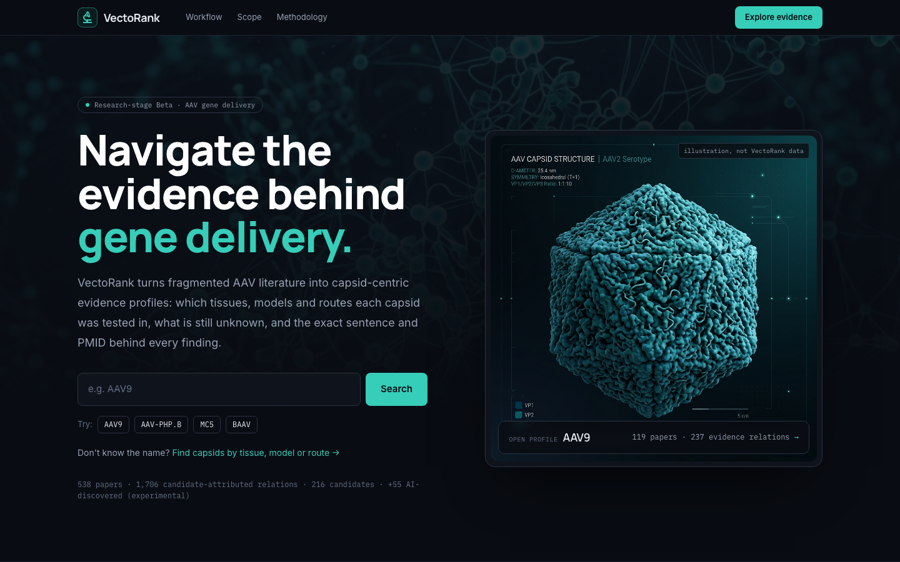
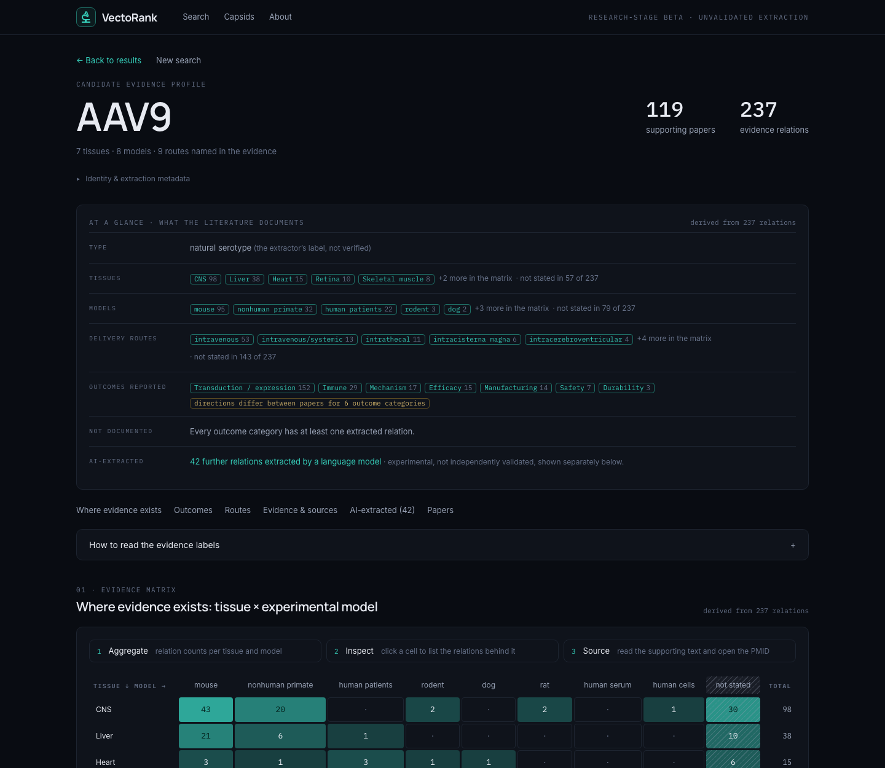
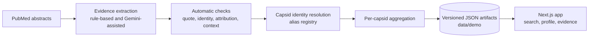

# VectoRank

**An evidence explorer for AAV gene-delivery capsids: every statement links to a sentence in a named paper.**

### Live demo: [vectorank.vercel.app](https://vectorank.vercel.app)

*Research-stage Beta. An independently developed prototype.*



## The scientific problem

Adeno-associated virus (AAV) capsids are the main delivery vehicles in gene therapy, and hundreds of natural and
engineered variants have been reported. What is known about any one capsid is scattered across thousands of papers, in
free text: which tissue it reached, in which species, by which route, compared with what, and with what result. A
researcher choosing a capsid for an experiment has to rebuild that picture by hand, and papers differ in design, so
results from different studies are often not directly comparable.

## What VectoRank does

VectoRank reads the titles and abstracts of a corpus of AAV papers and turns them into **capsid-centred evidence
profiles**. Search a capsid by name or alias (for example `AAV9`, or `AAV-PHP.B`), or choose a tissue, model and route,
and open a profile that shows what the literature documents for that capsid, what it does not state, and the exact source
sentence and PubMed record behind each finding.

It organises evidence. It does **not** rank capsids, name a best vector, or predict tropism, immunogenicity,
manufacturability or efficacy.



## Key capabilities

- **Capsid-first search** by name or alias, with identity resolution so that spelling variants reach one profile
  (`AAV-PHP.B` finds the same engineered variant that some papers write `AAV9-PHP.B`).
- **At-a-glance profiles**: tissues, models, delivery routes and outcome types documented for a capsid, with counts.
- **Evidence matrix** (tissue × experimental model): each cell counts extracted findings and opens them.
- **Source tracing**: every finding links to its paper on PubMed; where the licence allows, the original sentence is shown.
- **Honest absence**: when a paper does not state a tissue, model or route, the page says "not stated". It is never
  filled in, and it is never read as a negative result.
- **Conflicts stay visible**: where papers disagree on direction for an outcome, the profile says so.

## Technical architecture and data flow



Ingestion, extraction, identity resolution and aggregation run **at build time** and write schema-versioned artifacts.
The web application only reads those artifacts; it has no database, no API keys and no runtime model calls. Any
filtering by tissue, model or route happens at query time over the aggregated evidence.

## Scientific evidence extraction and provenance

- **Two extraction paths, never merged.** Fixed text rules and a language model (Google Gemini Flash, with a versioned
  prompt and schema) read the same abstracts. Their results are displayed separately; the AI-extracted layer is labelled.
- **Provenance is mandatory.** A relation is kept only if its quote occurs verbatim in the abstract and its capsid is
  named in the cited sentence.
- **Withholding by deterministic rules.** Claims are held back when an effect is attributable to a treatment, dose,
  cargo, promoter or immune cell rather than the capsid; when the capsid is unnamed or ambiguous; when the result is
  prospective rather than observed; or when a tissue, model or route fails a vocabulary check. Names that are mutations,
  accession numbers, peptides or non-AAV viruses cannot become capsid profiles.
- **Identity is resolved before aggregation.** Typographic variants merge; pseudotypes, mutants and cargo variants do
  not. Ambiguous names stay `unresolved` rather than being guessed. See [`pipeline/`](pipeline/).
- **Current corpus.** 538 papers; 216 rule-based capsid profiles from 1,706 relations. The language-model pass read
  1,875 relations from 221 papers; after the checks, 432 claims are shown on existing profiles and 97 on 55
  AI-discovered capsids, and 1,328 are withheld.

## Technology stack

Next.js 16 · React 19 · TypeScript · Tailwind CSS 4 (web application, deployed on Vercel) · Python 3 standard library
(identity resolution and evidence checks) · Google Gemini Flash (build-time extraction) · NCBI PubMed and Europe PMC
(bibliographic metadata and licence information).

## Current status and limitations

VectoRank is a **Beta research prototype**.

- **Not independently validated.** The rule-based extractor was measured only on a 30-paper, LLM-assisted development
  set (precision 0.52, recall 0.81); that is a development number, not a held-out result. The Gemini-assisted
  extraction has not been measured. An independent, human-annotated evaluation (internally called P4-B) is **planned
  and has not been run.** An informal review of a small sample found incomplete or misleading relations, which is why
  the withholding rules exist.
- **Abstracts only**, not full texts. Context given only in a paper's methods is missing.
- **Evidence from different experimental conditions is not automatically comparable.** A larger count means more
  extracted findings, not a better capsid.
- **No validated capsid-performance ranking or prediction is offered.**
- Some capsid names rest on textual cues in a sentence; AI-discovered capsids are labelled as unverified.

## Future development

- The independent, human-annotated evaluation, before any accuracy claim is made.
- Capsid comparison restricted to like-for-like experiments (same tissue, model and route), with mismatches shown
  rather than averaged away.
- Richer structured profiles from existing evidence, and better handling of full-text context.

## Repository contents

```
app/            Next.js pages and components (search, results, capsid profile, about)
lib/profiles/   typed loaders and query logic over the evidence artifacts
data/demo/      the two generated evidence artifacts the app reads (see NOTICE.md)
pipeline/       audited extracts of the processing code: identity resolver and alias registry,
                evidence checks, the extraction prompt, and their tests
scripts/        self-check of the dataset and a crawl of a running server
docs/img/       screenshots
```

Not included, and kept private: the ingestion and extraction runners, the evaluation harness and its reference data,
and unpublished validation work. Run it locally:

```bash
npm ci && npm run build && npm start      # http://localhost:3000
npm run check                             # dataset and repository self-check
python3 pipeline/tests/test_pipeline.py   # evidence-check tests
python3 pipeline/tests/test_identity_resolver.py
```

## Authorship and acknowledgements

Designed and developed by Lorenzo Broccoli as an independent project. AI coding assistance (Claude Code) was used
during development, and Google Gemini performs the language-model extraction described above; all scientific design
decisions, checks and conclusions are the author's responsibility.

Bibliographic data and licence metadata come from NCBI PubMed and Europe PMC. The articles belong to their authors and
publishers. See [`NOTICE.md`](NOTICE.md) for third-party material and [`LICENSING.md`](LICENSING.md) for the open licence
options. **No licence has been applied yet, so all rights are reserved.**
